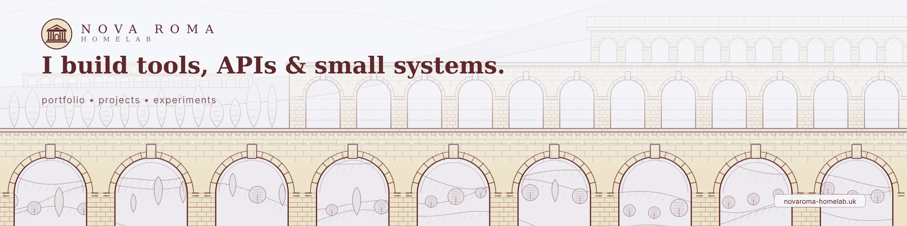
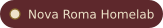
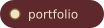
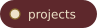
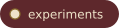
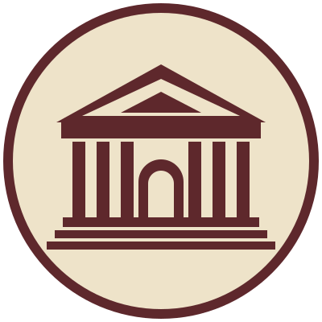
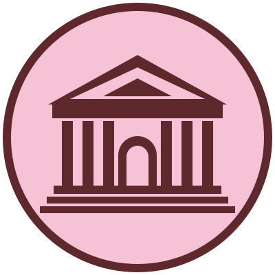
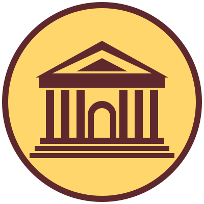
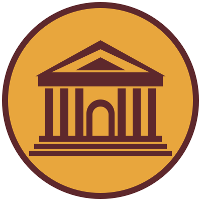
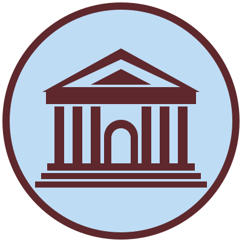

<!--
  Profilseite der Organisation. Gehört nach Novaroma-Homelab/.github/profile/README.md.
  Den ganzen Ordner org-profile/ dorthin kopieren (README.md, Bilder, badges, seasons),
  damit die relativen Bildpfade im öffentlichen Repo funktionieren.
-->

<picture>
  <source media="(prefers-color-scheme: dark)" srcset="./header-dark.png">
  
</picture>

  
  
  
  
  

## Nova Roma Homelab

I build tools, APIs & small systems.

A homelab project with its own design language: burgundy `#5E282C` and cream `#EEE3C9`, five seasons, light and dark.

  &nbsp;&nbsp;
  &nbsp;&nbsp;
  &nbsp;&nbsp;
  &nbsp;&nbsp;
  

## Projects

- [novaroma-vscode](https://github.com/Novaroma-Homelab/novaroma-vscode): the Nova Roma extension for Visual Studio Code
- [Website](https://novaroma-homelab.uk): portfolio and projects

<!-- Weitere Repos hier eintragen, sobald sie in der Organisation liegen. -->
